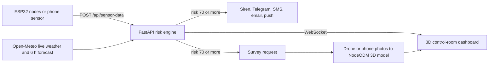

# ⛰ BhuRakshak — AI-based Rockfall Prediction & Alert System

**Low-cost sensor nodes on the pit wall, a live risk score for every zone, and alerts that reach workers' phones before a bench fails.**

Built by **Team paradoX** for open-pit mines. (The app UI and launcher still use the team's earlier name, *INNOVATRIX*.)


---

## Why

Open-pit benches fail with little visible warning, and most slopes are still checked by eye between shifts. Rain is a major trigger: DGMS found that side falls and falls of persons made up 34% of 288 fatal accidents in Indian non-coal mines (1999–2003), mostly in the monsoon months ([DGMS Circular No. 7, 2004](https://elibrarywcl.wordpress.com/wp-content/uploads/2015/02/dgms-cir_07_04-accident-in-opencast-mines.pdf)). Rain can be forecast, so the risk can be forecast too.

## How it works



1. **Sense** — each node streams vibration, tilt, rainfall, temperature and humidity every few seconds. Zones without a node get live weather from Open-Meteo.
2. **Predict** — every reading updates a 0–100 risk score for that zone, and forecast rain raises it before the rain arrives.
3. **Alert** — at 70% the siren sounds, registered people get Telegram / SMS / email / push messages, and a survey of that zone is requested.
4. **Confirm** — drone or phone photos are turned into a 3D model of the actual slope, viewable in the dashboard.

## Features

| Area | What you get |
|---|---|
| **3D pit map** | Six zones (A–F) coloured green → amber → red in real time, sensor masts that light up when a node is live, hover cards, click a zone to fly to it |
| **Zone analytics** | Risk gauge and live trend charts for risk, vibration RMS, tilt and rainfall |
| **Weather intelligence** | Open-Meteo (free, no API key). "RAIN INCOMING" badge and a risk boost when heavy rain is forecast |
| **Alerts** | Telegram, SMS (Twilio), email (SMTP), webhook and browser push; per-recipient severity and zone filters; cooldown so nobody gets spammed; High → Critical always goes out immediately |
| **Crew in pit** | Check workers in and out per zone; the dashboard warns how many people are standing in High/Critical zones |
| **Devices** | Sensor nodes and camera feeds (ESP32-CAM, IP Webcam, DroidCam) connect from the dashboard and show offline after 15 s of silence |
| **3D survey studio** | Upload or capture photos, reconstruct with NodeODM, or upload a ready `.ply/.glb/.obj`; orbit viewer with wireframe mode. A labelled sample model is included |
| **Phone as a sensor** | `sensor.html` turns any phone into a calibrated node (accelerometer + gyro) using the same API as the ESP32 |
| **Demo mode** | Press `D` to send a scripted rockfall build-up through the real API. A SIMULATION banner stays on screen the whole time |

---

## Quick start

**Requirements:** Python 3.10+ · Windows, macOS or Linux · optional: Docker (for 3D reconstruction), an ESP32 or a phone

### Windows (one click)

```powershell
cd backend
py -m pip install -r requirements.txt cryptography
py make_cert.py        # one time: HTTPS certificate for the phone bridge
```

Then double-click **`START_INNOVATRIX.bat`**. It starts the server (port 8000), the HTTPS bridge for phones (port 8443), NodeODM if Docker is running, and opens the dashboard at `http://127.0.0.1:8000`.

### Any OS (manual)

```bash
cd backend
pip install -r requirements.txt
python main.py                 # dashboard: http://localhost:8000
python tls_proxy.py            # optional, second terminal: HTTPS bridge for phone sensors
```

Press **`D`** on the dashboard to run the demo scenario, or **`?`** for the quick guide.

---

## Phone as a sensor node (no hardware needed)

1. Create the certificate once: `py backend/make_cert.py` (re-run if the laptop's IP changes).
2. Start the system with `START_INNOVATRIX.bat`.
3. Turn on the laptop's **Mobile hotspot** and connect the phone to it. College and office Wi-Fi usually block phone-to-laptop traffic, the hotspot avoids that.
4. On the phone open **`https://192.168.137.1:8443/sensor.html?zone=F`**, accept the certificate warning (iPhone: *Show Details → Visit Website*, then tap **ARM**; Android starts on its own).
5. Hold the phone still for 2.5 s while it calibrates. Shake it for vibration, tilt it for tilt.

> **To trigger an alert on stage:** shaking and tilting alone reach about 60% (Moderate), because vibration and tilt are 65% of the score. Push the phone page's rainfall slider to **30 mm → High (~78%)**, or **50 mm with 30°+ tilt → Critical (~86%)**.

If the phone can't reach the laptop, allow the two ports once in an **administrator** PowerShell:

```powershell
New-NetFirewallRule -DisplayName "BhuRakshak demo" -Direction Inbound -Protocol TCP -LocalPort 8000,8443 -Action Allow -Profile Any
```

## ESP32 sensor node

Open `esp32/sensor_node.ino` in the Arduino IDE and install **Adafruit MPU6050**, **Adafruit Unified Sensor**, **DHT sensor library** and **ArduinoJson**. Set these at the top of the sketch:

```cpp
const char* WIFI_SSID     = "YOUR_WIFI_SSID";
const char* WIFI_PASSWORD = "YOUR_WIFI_PASSWORD";
const char* SERVER_URL    = "http://<laptop-ip>:8000/api/sensor-data";
const char* ZONE_ID       = "A";   // A–F, one letter per physical node
```

| Part | ESP32 pin |
|---|---|
| MPU6050 VCC / GND | 3V3 / GND |
| MPU6050 SDA / SCL | GPIO21 / GPIO22 |
| Rain sensor (analog out) | GPIO34 |
| DHT22 data | GPIO27 (10 kΩ pull-up to 3V3) |

Serial Monitor (115200 baud) prints `POST -> 200` once the node reaches the server, and its zone turns *connected* on the dashboard.

---

## Risk model

```
risk = 40 × vibration + 25 × tilt + 20 × rainfall + 15 × geology  (+ forecast boost, max +10)
```

| Input | Normalised against | Weight |
|---|---|---|
| Vibration — RMS of the last 10 readings, gravity removed | 2.0 m/s² | 40% |
| Tilt — angle from vertical | 30° | 25% |
| Rainfall | 50 mm | 20% |
| Geology — fixed per-zone base risk (`ZONES` in `main.py`) | 100 | 15% |
| Forecast boost — 10 mm or more of rain expected in the next 6 h | +10 at 30 mm | added |

| Score | Level | What happens |
|---|---|---|
| < 40 | Low | — |
| 40–69 | Moderate | logged |
| 70–84 | High | siren, messages, survey requested |
| ≥ 85 | Critical | same, and bypasses the alert cooldown |

The weights are hand-set for now. `compute_risk()` in `backend/main.py` is the only function that would change to use a trained model (e.g. XGBoost); ingestion, alerts and the dashboard stay the same.

## Alerts setup

Open **Alert Channels → ⚙ Manage channels** in the dashboard:

- **Telegram** (free): create a bot with **@BotFather**, paste its token, then add each person's chat ID (they get it from **@userinfobot**).
- **Email**: any SMTP account. For Gmail use an App Password, not your real password.
- **SMS**: Twilio SID, auth token and sender number.
- **Webhook**: any URL receives the full alert as JSON.
- **🔔 push**: browser notifications on the device showing the dashboard, no setup.

**Send test alert** fires a clearly labelled drill to everyone. Settings are saved to `backend/notify_config.json`, which is git-ignored.

## 3D surveys

- **NodeODM (one click):** `docker run -ti -p 3001:3000 opendronemap/nodeodm`, then open a zone's survey, add 30+ overlapping photos (70–80% overlap) and press **Reconstruct**. Takes roughly 10–30 minutes.
- **Ready model:** scan with an app such as KIRI Engine or process in WebODM, then upload the `.ply`, `.glb` or `.obj` (+ `.mtl` and textures).

## Keyboard shortcuts

`1`–`6` focus a zone · `D` demo scenario · `Space` auto-rotate · `R` reset view · `S` siren · `?` quick guide

## API

| Method | Endpoint | Purpose |
|---|---|---|
| POST | `/api/sensor-data` | Node reading `{zone_id, vibration, tilt, rainfall, temperature, humidity}` |
| GET | `/api/zones` · `/api/alerts` · `/api/devices` | Current state |
| POST | `/api/workers/{zone}` | Crew headcount `{count}` or `{delta}` |
| POST | `/api/drone/{zone}/complete?crack_detected=true` | Close a survey; a confirmed crack raises the zone's base risk |
| POST | `/api/camera/connect` · `/api/camera/{zone}/disconnect` | Camera streams |
| GET / POST / DELETE | `/api/surveys` · `/api/survey/{zone}/images` · `/model` · `/process` | 3D surveys |
| GET | `/api/odm/status` | Is NodeODM reachable |
| GET / POST | `/api/weather` · `/api/weather/config` | Weather and mine location |
| GET / POST / DELETE | `/api/notify/config` · `/subscribers` · `/test` · `/log` | Alert channels |
| WS | `/ws` | Live updates to the dashboard |

## Project structure

```
backend/
  main.py            FastAPI app: ingestion, risk engine, WebSocket, surveys, devices, crew
  notify.py          Telegram / SMS / email / webhook dispatch with cooldown
  weather.py         Open-Meteo live weather and forecast boost
  tls_proxy.py       HTTPS bridge (port 8443) so phones can use motion sensors
  make_cert.py       Creates the self-signed certificate for the bridge
  surveys/sample/    Sample 3D reconstruction
frontend/
  index.html         Control-room dashboard (Three.js)
  sensor.html        Phone sensor node
  loaders/           Three.js model loaders (bundled, works offline)
esp32/
  sensor_node.ino    ESP32 firmware
START_INNOVATRIX.bat One-click launcher for Windows
```

## What is real and what is not yet

- **Real:** sensor readings from ESP32 nodes or phones, live weather, risk scoring, alerts to real phones, the dashboard and 3D reconstruction from real photos.
- **Labelled simulation:** the `D` demo scenario.
- **Not built yet:** a trained ML model (the formula is hand-weighted), crack detection on survey photos, per-zone geology from a real DEM, LoRa mesh networking, and a database for long-term history.

## Team

**Team paradoX**
